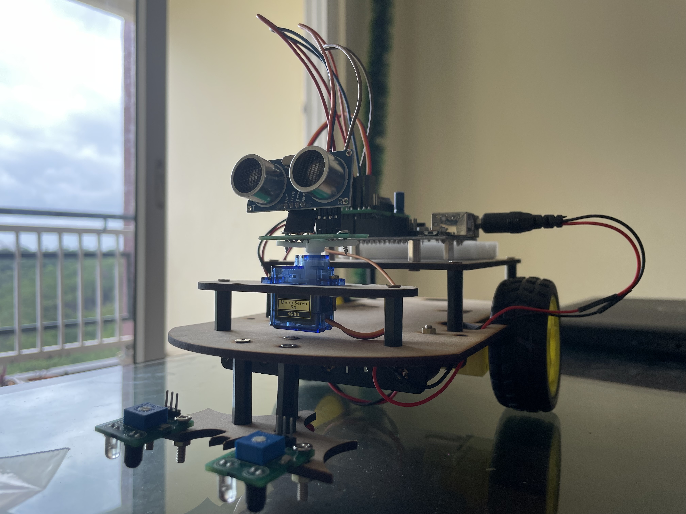
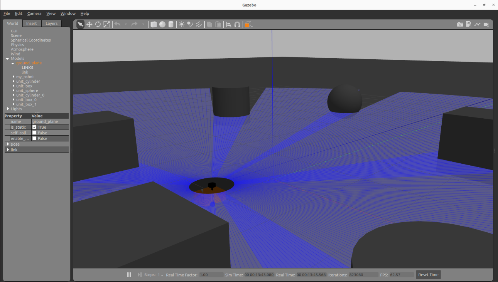

# ViAD-Robo-Navigation-System (WiML@NeurIPS)

Selected for WiML@NeurIPS: https://openreview.net/forum?id=3mheFjRGDF 

For decades, visualization and comprehension of the real world environment has been a bottleneck in building
robust navigation robotics systems. It has been quite popular to utilize LiDAR/ultrasonic cameras in order to
understand 3-D space. This method of visualization leverages the obstacle coordinates in order to compute its
distance from the obstacle, however it acts as a limitation to the real-time contextual scene understanding.
Clutter, new lighting or any real-time changes in the environment usually confuses the system. When it came
to planning, it was quite popular to use Nav2 which followed a very rigid planning pattern and a rule based
approach. For example: “if an obstacle is detected, turn right, else go straight”. Its inability to adapt to
dynamic tasks like “avoid moving objects” made it inflexible. Along with this, it lacked natural language
control. In recent times, LLMs have been utilized to overcome this issue. When it came to low-level
execution like directing wheel speed and frequency, it lacked memory based learning nor did it have any way
to leverage offline datasets for policy improvement. Commands could be only understood by either feeding
coordinates or numeric terms and had no semantic grounding for user commands. In order to overcome these
issues, we propose ViAD - Visualize, Analyse and Decide methodology. It consists of leveraging Vision
Transformers to get the raw visual perception of the environment, an LLM for comprehension and strategic
planning, and Decision Transformers to implement low level execution leveraging memory-based learning.
Each component is crucial to make our robot more adaptable, understandable and strategically navigable.

It integrates **Vision Transformers (ViT)** for perception, **LLMs** for reasoning, and **Decision Transformers (DT)** for low-level control, all built on **ROS 2 Humble** with Gazebo simulation and Arduino hardware. 
- **Vision Transformers** for semantic scene understanding. **LLMs** to interpret natural-language commands and choose subgoals. **Decision Transformers** for data-driven low-level control.**ROS 2 + Gazebo** for simulation-to-real transfer.**Arduino Nano + Sensors** for affordable hardware deployment

  

    
  

  

    
  

---

## 📋 Prerequisites

### Software

1. **Operating System**  
   - Windows 10 (2004+) or Windows 11 with WSL 2 support  
   - Ubuntu 22.04 under WSL 2  
2. **IDE & Extensions**  
   - Visual Studio Code on Windows  
   - **Remote – WSL** extension  
3. **ROS 2 & Gazebo**  
   - ROS 2 Humble Hawksbill (`ros-humble-desktop`)  
   - Gazebo 11 (`gazebo`, `libgazebo-dev`)  
   - ROS 2–Gazebo bridge packages (`ros-humble-gazebo-ros-pkgs`, `ros-humble-gazebo-plugins`)  
4. **Build Tools**  
   - Python 3 & pip  
   - `python3-colcon-common-extensions`  

### Hardware
 
**Core components you’ll need:**

- **Microcontroller:** Arduino Nano (or Uno)  
- **Motor driver:** L293D (or L298N) dual H-bridge  
- **Drive:**  
  - 2 × DC motors + wheels  
  - Differential‐drive chassis (3D-printed or laser-cut)  
- **Sensors:**  
  - 3 × IR line-tracking sensors (e.g. TCRT5000)  
  - 1 × HC-SR04 ultrasonic distance sensor  
- **Power & wiring:**  
  - 6 × AA or 7.4 V LiPo battery pack  
  - Jumper wires & breadboard  
- **Extras (optional):** IMU, LiDAR, LiPo charger, enclosure  

---

## Install ROS and Gazebo deps
- sudo apt update
- sudo apt install -y \
- curl gnupg lsb-release \
- ros-humble-desktop \
- gazebo libgazebo-dev \
- ros-humble-gazebo-ros-pkgs ros-humble-gazebo-plugins \
- python3-colcon-common-extensions

## Build the workspace
### Source ROS 2
source /opt/ros/humble/setup.bash

### Build
colcon build --merge-install

### Overlay
source install/setup.bash

## ▶️ Running Simulation
#### Launch Gazebo simulation
ros2 launch rav_bot rav_gazebo.launch.py

#### Run ViT perception node
ros2 run rav_bot perception_node

#### Run LLM planner
ros2 run rav_bot llm_planner_node --ros-args --param model=phi-3-mini

# Run Decision Transformer policy
ros2 run rav_bot policy_server_node --ros-args --param ckpt=dt_best.ckpt

##  Deploying on Real Hardware
#### Flash Arduino firmware
arduino-cli upload -p /dev/ttyUSB0 --fqbn arduino:avr:nano firmware/

#### Start micro-ROS agent
ros2 run micro_ros_agent micro_ros_agent serial --dev /dev/ttyUSB0

#### Send velocity commands
ros2 topic pub /rav_bot/cmd_vel geometry_msgs/Twist ...

#### Dataset + Training (Decision Transformer)
#### Collect expert rollouts
ros2 launch rav_bot nav2_expert.launch.py --ros-args -p record:=true

#### Train DT
python train_dt.py --dataset data/rosbags --config configs/dt.yaml

#### Evaluate in Gazebo
ros2 run rav_bot policy_server_node --ros-args -p ckpt=outputs/dt_best.ckpt

